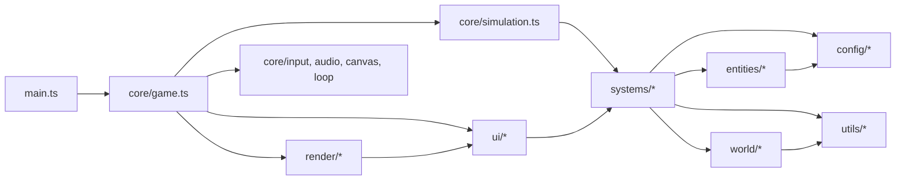
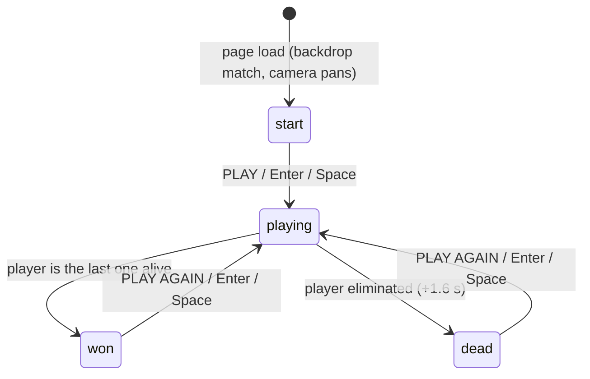
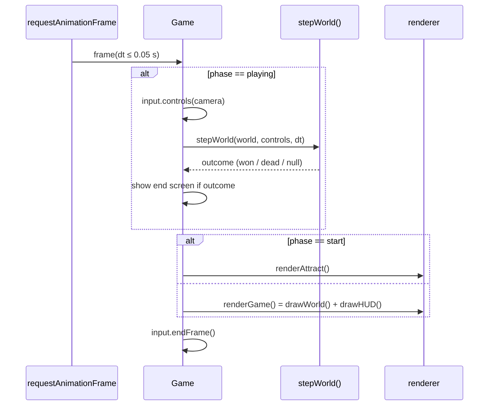

# Initial project setup

This document explains what was done when Zone Royale was turned from a single-file
prototype (one ~900-line [`index.html`](./init_code.html) with inline JavaScript) into a structured TypeScript
project. It covers the goals, the tech stack, the folder layout and the role of every module,
how the game loop and systems fit together, how to run/build/test, and the conventions to
follow when contributing.

## 1. Purpose

The prototype proved the game was fun, but everything lived in one file with global
mutable state, which made it hard to test, extend or work on collaboratively. The goals of
this setup were:

- **Same game.** Gameplay, tuning values, visuals, controls and sounds are unchanged.
- **Real project.** TypeScript in strict mode, a Vite build, git history, linting and formatting.
- **Testable logic.** Game rules are pure TypeScript with no DOM access, so they can be
  unit-tested in Node and a whole match can be simulated headlessly.
- **Clear structure.** A conventional game layout (core / entities / systems / world / render / ui)
  so new features have an obvious home.
- **Documented code.** Every function, method, class, interface, type and exported constant
  has a TSDoc comment (enforced by ESLint).

## 2. Tech stack

| Tool                          | Role                                                                              |
| ----------------------------- | --------------------------------------------------------------------------------- |
| TypeScript 6 (`strict`)       | Language. Extra checks: `noUnusedLocals`, `noImplicitReturns`, ...                |
| Vite 8                        | Dev server with HMR and the production bundler (`base: './'`)                     |
| Vitest 4                      | Unit test runner (Node environment, shares the Vite config)                       |
| ESLint 10 + typescript-eslint | Linting; `eslint-plugin-jsdoc` requires docs, `eslint-plugin-tsdoc` checks syntax |
| Prettier 3                    | Code formatting (single quotes, 100 columns)                                      |
| Canvas 2D + Web Audio         | Rendering and procedurally synthesised sound effects (no assets)                  |
| pnpm                          | Package manager; lockfile is `pnpm-lock.yaml`                                       |
| playwright-core (dev only)    | Headless-browser smoke test of the production build (`pnpm e2e`)                  |

The game has **zero runtime dependencies**; the production bundle is about 40 kB (15 kB gzipped).

## 3. Folder structure

```
zone-royale/
├── index.html              Page shell: canvas + start/end overlay markup
├── public/favicon.svg      Static assets copied as-is into dist/
├── src/
│   ├── main.ts             Entry point: creates Game, starts the loop, exposes window.__game
│   ├── styles/main.css     Overlay and page styles
│   ├── config/             Pure data: tuning values and tables
│   ├── core/               Engine-level plumbing and the simulation step
│   ├── entities/           Data types (and factories) for things in the world
│   ├── systems/            Gameplay rules operating on the World
│   ├── world/              Procedural map generation
│   ├── render/             Canvas drawing of the world (world space)
│   ├── ui/                 HUD, minimap, kill feed (screen space) and HTML screens
│   └── utils/              Generic helpers
├── tests/                  Vitest unit tests (+ helpers.ts to build small worlds)
├── scripts/e2e.mjs         Serves dist/ and plays it in headless Chromium
└── docs/                   Documentation (this file, index; e2e screenshot is local-only)
```

### Module reference

**`src/config`** – no logic, only data.

| File           | Contents                                                              |
| -------------- | --------------------------------------------------------------------- |
| `constants.ts` | Map size, speeds, sight/pickup ranges, HP/armor caps, timings, colors |
| `weapons.ts`   | `WEAPONS` stat table (5 weapons), ammo families, colors, box sizes    |
| `zone.ts`      | `PHASES` (6 wait/shrink/radius/dps entries) and drift factors         |
| `bots.ts`      | Bot names and body colors                                             |

**`src/core`** – the parts that glue everything together.

| File            | Contents                                                                                 |
| --------------- | ---------------------------------------------------------------------------------------- |
| `world.ts`      | The `World` interface: all mutable match state in one object; `SoundSink` abstraction    |
| `simulation.ts` | `stepWorld()` – runs every system in a fixed order for one step (no DOM)                 |
| `game.ts`       | `Game` class – owns the world, input, audio, screens; state transitions; `window.__game` |
| `loop.ts`       | `requestAnimationFrame` loop with a clamped delta (max 50 ms)                            |
| `input.ts`      | Keyboard/mouse tracking and `readControls()` → `PlayerControls`                          |
| `camera.ts`     | `Camera` – follow, culling (`inView`), screen↔world conversion                           |
| `canvas.ts`     | `Viewport` – full-window, high-DPI canvas sizing                                         |
| `audio.ts`      | `AudioEngine` – Web Audio synthesis of shots, hits, pickups, deaths                      |

**`src/entities`** – plain data shapes.

| File         | Contents                                                                 |
| ------------ | ------------------------------------------------------------------------ |
| `entity.ts`  | `Entity` (player and bots), `BotBrain` (AI memory), `createEntity()`     |
| `loot.ts`    | `LootItem` union (weapon/ammo/health/armor), `lootName()`, `lootColor()` |
| `bullet.ts`  | `Bullet`                                                                 |
| `effects.ts` | `Particle`, `Floater` (damage numbers), `KillFeedEntry`, `Toast`         |

**`src/systems`** – the rules of the game. Each takes the `World` (or smaller inputs) explicitly.

| File             | Contents                                                                                |
| ---------------- | --------------------------------------------------------------------------------------- |
| `collision.ts`   | Segment-vs-obstacle, line of sight, free-space checks, push-out and body separation     |
| `weapons.ts`     | Slot switching, reload start/finish, cooldown timers, `tryShoot()` (bullets, spread)    |
| `combat.ts`      | `splitDamage()` (armor), `applyDamage()`, `eliminate()` (placement, drops, kill feed)   |
| `inventory.ts`   | Pickup rules: slot choice, `applyLoot()`, `playerPickup()`, `botWants()`                |
| `lootSpawner.ts` | Loot tables and initial distribution in houses and the open                             |
| `zone.ts`        | `Zone` state, phase setup, shrink interpolation, dps, tick damage                       |
| `ai.ts`          | `updateBot()` plus exported decision helpers (targeting, range keeping, safety, wander) |
| `player.ts`      | `updatePlayer()` – applies `PlayerControls` (move, aim, fire, ammo auto-pickup)         |
| `bullets.ts`     | Swept bullet movement and hit resolution                                                |
| `effects.ts`     | Ageing of particles, damage numbers, kill feed, toast and screen shake                  |
| `feedback.ts`    | Toast messages and kill-feed helpers                                                    |
| `sound.ts`       | Distance attenuation and per-step sound budget                                          |
| `match.ts`       | `createMatch()`, spawn points, `checkMatchEnd()`, `buildEndSummary()`                   |

**`src/world`** – `mapgen.ts` (houses, rocks, trees, decor), `houses.ts` (walls with two doors),
`types.ts` (obstacle/house/decor types).

**`src/render`** – `renderer.ts` (frame composition, screen shake, attract-mode pan),
`worldRenderer.ts` (layered world drawing), `entityRenderer.ts`, `lootRenderer.ts`, `draw.ts`
(rounded rects, panels, colors).

**`src/ui`** – `hud.ts` (counters, zone banner, vitals, weapon slots, prompts, vignettes, crosshair),
`minimap.ts`, `killFeed.ts`, `screens.ts` (HTML start/end overlays).

**`src/utils`** – `math.ts` (clamp, lerp, distances, angle wrap, time format), `random.ts`
(swappable/seeded RNG), `geometry.ts` (segment–circle and segment–rectangle tests), `color.ts`.

### Dependency direction



Rules: `systems`, `entities`, `world`, `config` and `utils` never touch the DOM.
Only `core/game.ts`, `core/input.ts`, `core/canvas.ts`, `core/audio.ts`, `core/loop.ts`,
`render/*` and `ui/*` use browser APIs.

## 4. How the game loop and systems fit together

### State machine



### One frame



### Order of systems inside `stepWorld()`

1. advance `gameTime`, reset the sound budget (6 sounds per step)
2. **zone** – wait / shrink / next phase (adds "The zone is closing in!" to the kill feed)
3. **player** – movement, aim, firing, ammo auto-pickup from `PlayerControls`
4. for each living entity: **AI** (`updateBot`), weapon timers (cooldown, reload), hit flash, movement
5. **separation** of overlapping combatants, then **collision** against obstacles and map edges
6. **zone damage** every 0.5 s outside the circle (ignores armor)
7. **bullets** – swept hit tests → `applyDamage()` → `eliminate()`
8. **effects** – particles, damage numbers, kill feed, toast, screen shake decay
9. **camera** follows the player (or the killer / any survivor after death)
10. **match end** check

The order is the same as in the prototype, so the game behaves identically.

### Data flow

- All state lives in a single `World` object created by `createMatch()`. Systems mutate it;
  renderers only read it.
- Side effects that would need the browser are abstracted: sound goes through a
  `SoundSink` (`null` in tests), and messages/particles are just data in the world.
- Randomness goes through `utils/random.ts`. Tests call `setRandomSource(createSeededRandom(seed))`
  to make map generation, AI and whole matches deterministic.
- `window.__game` exposes a read-only view of the match plus `update(dt)` for automated browser tests.

## 5. Running, building and testing

```bash
pnpm install         # once (npm/yarn/bun install are rejected by preinstall)
pnpm dev             # dev server with hot reload
pnpm typecheck       # strict TypeScript check
pnpm lint            # ESLint + TSDoc rules (0 warnings allowed)
pnpm test            # unit tests (Vitest)
pnpm build           # type-check + production build into dist/
pnpm preview         # serve dist/ locally
pnpm e2e             # play dist/ in headless Chromium, write docs/screenshot.png
```

`pnpm e2e` needs a Chromium/Chrome binary. It uses `CHROME_PATH` if set, otherwise
`/usr/bin/google-chrome`. It serves `dist/` under a sub-path (like GitHub Pages), starts a match,
simulates WASD movement, shooting, reloading, picking up and switching weapons, fast-forwards a full
match to the end screen, restarts, and fails on any console error or failed request.

### What the unit tests cover

| Test file           | Area                                                                                   |
| ------------------- | -------------------------------------------------------------------------------------- |
| `math.test.ts`      | clamp, lerp, distances, angle wrapping, time formatting, color shading, seeded RNG     |
| `collision.test.ts` | segment–circle/rect, line of sight, free space, push-out, body separation, house walls |
| `weapons.test.ts`   | weapon table sanity, ammo checks, switching, reload timing and refill, firing, pellets |
| `combat.test.ts`    | armor absorption, damage credit, attacker memory, eliminations, drops, kill feed cap   |
| `inventory.test.ts` | loot labels, slot choice, pickup effects and caps, refusal rules, bot loot preferences |
| `loot.test.ts`      | loot tables, weapon + ammo bundles, map generation, loot placement                     |
| `zone.test.ts`      | phase table, drift limits, wait → shrink → next phase → final, dps, tick damage        |
| `ai.test.ts`        | target selection, retaliation, range keeping, aim error, safety, wander, `updateBot()` |
| `match.test.ts`     | win/defeat conditions, end summary, spawning, full headless match simulations          |
| `core.test.ts`      | camera, input mapping, frame delta clamp, player controls, sound falloff, HUD text     |

## 6. Contributor conventions

- **Branching & commits.** `main` is always releasable. Use short-lived feature branches and
  [Conventional Commits](https://www.conventionalcommits.org/) (`feat:`, `fix:`, `refactor:`,
  `test:`, `docs:`, `chore:`). Keep commits small and focused.
- **Before pushing** run `pnpm typecheck && pnpm lint && pnpm test && pnpm build`.
- **Keep logic out of the DOM.** New rules go in `src/systems` (or `src/entities` for data shapes)
  and take the `World` or plain values as parameters. Drawing goes in `src/render` / `src/ui`.
- **Tuning lives in `src/config`.** No magic numbers in systems when the value is a design knob.
- **Randomness** only through `utils/random.ts` (never `Math.random()` directly in logic) so tests
  can seed it. (`core/audio.ts` noise generation is the one deliberate exception.)
- **Docs.** Every function, method, class, interface, interface property, type alias and exported
  constant needs a TSDoc comment (`/** ... */` with `@param name - description` and `@returns`).
  ESLint fails the build otherwise.
- **Tests.** Add or update a Vitest test for every change to game rules. Use `tests/helpers.ts`
  (`makeWorld()`, `bot()`) to set up small scenarios and a seeded RNG for determinism.
- **Formatting** is Prettier's job: run `pnpm format`; don't hand-format.
- **Naming.** `camelCase` for functions/variables, `PascalCase` for types/classes,
  `UPPER_SNAKE_CASE` for constants; one module per concept, file names in `camelCase.ts`.
- **New docs** go in `docs/` and must be listed in [docs/README.md](README.md).

## 7. Differences from the prototype

The refactor is intended to be behaviour-preserving. Small, deliberate changes:

- A favicon (`public/favicon.svg`) was added so browsers don't log a 404 for `/favicon.ico`.
- `window.__game` is created by `Game.debugHandle()`; it exposes the same fields as before
  (`state`, `player`, `entities`, `zone`, `loot`, `update(dt)`).
- The internal `Bullet.px/py` fields (written but never read) were dropped.
- `updateZone()` now _returns_ zone events instead of writing to the kill feed itself; the
  simulation step writes the same "The zone is closing in!" message.
