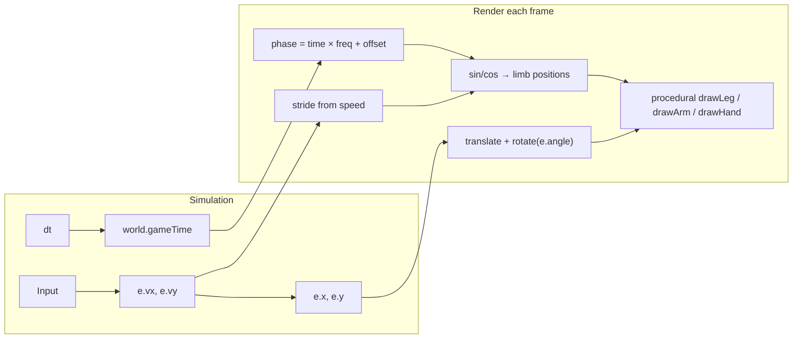
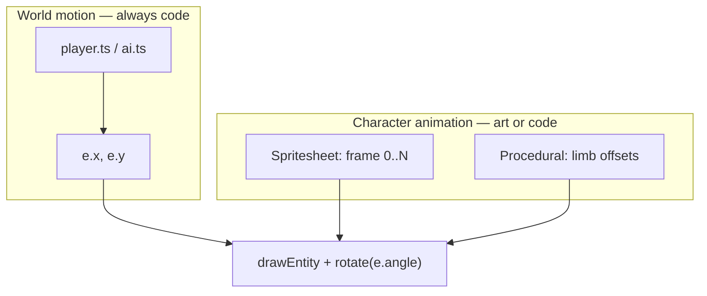

# Combatant art (procedural characters)

This document describes how player and bot visuals replaced the original circle bodies:
procedural Canvas 2D drawing, walk animation driven by velocity and match time, optional
reference SVGs, and how a future PNG spritesheet would plug in.

## What changed

- **Before:** Combatants were filled circles with a rotated gun rectangle and two small hand dots ([`entityRenderer.ts`](../src/render/entityRenderer.ts)).
- **After:** A humanoid silhouette (torso, head, two arms with hands, two legs with boots, weapon) is drawn each frame in [`spriteAssets.ts`](../src/render/spriteAssets.ts). Player and bots share the same drawer; bots use `Entity.color` for the jacket.

Collision is unchanged: still a circle (`ENTITY_RADIUS` in [`constants.ts`](../src/config/constants.ts)). Limbs are cosmetic only.

## Where it lives

| Path | Role |
| ---- | ---- |
| [`src/render/spriteAssets.ts`](../src/render/spriteAssets.ts) | `drawCombatantSprite()` — limbs, hands, gun |
| [`src/render/entityRenderer.ts`](../src/render/entityRenderer.ts) | Shadow, transform, armor ring, hit flash, bot name/HP; calls sprite drawer |
| [`src/render/worldRenderer.ts`](../src/render/worldRenderer.ts) | Passes `world.gameTime` into `drawEntity()` |
| [`src/main.ts`](../src/main.ts) | Calls `loadCombatantSprites()` at boot (no-op today; kept for a future atlas) |
| [`src/assets/sprites/player.svg`](../src/assets/sprites/player.svg), [`bot.svg`](../src/assets/sprites/bot.svg) | **Preview / reference only** — not loaded by the game |
| [`docs/sample-designs/`](../docs/sample-designs/) | `preview.html`, concept JPG, copies of the SVGs |

## Simulation vs animation

Movement and walk motion are separate:

- **Position** comes from systems (`player.ts`, `ai.ts`, collision) updating `x` / `y` from velocity.
- **Walk cycle** is math at draw time: if `hypot(vx, vy)` is above a small threshold, `stride` scales `sin(phase)` / `cos(phase)` offsets for feet, knees, and hands. Idle → `stride === 0` → static pose.
- **Per-entity desync:** `phaseOffset` from `e.x` and `e.y` so bots do not march in lockstep.

`gameTime` advances in [`simulation.ts`](../src/core/simulation.ts) (`world.gameTime += dt`).

## Boot API

- `loadCombatantSprites()` — resolves immediately; reserved for loading a PNG atlas later.
- `combatantSpritesReady()` — always `true` (procedural art needs no assets).

## Format choice: SVG vs PNG (and WebP)

Most 2D games ship characters as **raster** art, not SVG.

| | **PNG / WebP** | **SVG** |
| --- | --- | --- |
| **Typical use** | Animated characters, spritesheets, VFX | UI, logos, static icons, map markers |
| **Animation** | Frame sequences in one atlas; fast `drawImage` | Possible but uncommon in Canvas games; costly to animate many paths per frame |
| **Look** | Pixel art or painted art at a chosen resolution (e.g. 64×64 per frame) | Crisp at any zoom; better for non-character graphics |
| **Pipeline** | Aseprite, Photoshop, exports + optional JSON atlas | Figma/Inkscape — often **exported to PNG** for runtime anyway |

**WebP** is like PNG with transparency, usually smaller files; modern browsers support it well. For this project, **PNG or WebP in a spritesheet** is the usual end state; files under [`src/assets/sprites/`](../src/assets/sprites/) are **SVG reference only** and are not loaded at runtime.

## Animation: spritesheet frames vs code-driven limbs

These are different layers:

| Layer | What moves | How |
| --- | --- | --- |
| **World motion** | Whole character on the map | Simulation: `e.x`, `e.y` from `e.vx`, `e.vy` (every game does this) |
| **Character animation** | Legs, arms, idle vs walk | Either **authored frames** or **procedural math** |

| Approach | What it is | Best for |
| --- | --- | --- |
| **Spritesheet** | Artist draws idle, walk 1…N, shoot…; code picks **frame index** each tick | Readable silhouettes, “real” game feel, hand-tuned motion |
| **Code-driven** (current) | Same logical pose rebuilt each frame; `sin` / `cos` offset hips, knees, hands | Fast iteration, no art pipeline, stylized / prototype look |

**Rule of thumb:** if the **look** of walk/shoot matters, use a **spritesheet** (or skeletal tools like Spine later). If you only need **something human-shaped** while gameplay is in flux, procedural drawing in [`spriteAssets.ts`](../src/render/spriteAssets.ts) is fine until art is ready.

**Recommendation for Zone Royale:** one row of walk frames (4–8), one idle frame, drawn facing +X and rotated with `e.angle` like today; keep armor ring, hit flash, and bot name/HP as code overlays in [`entityRenderer.ts`](../src/render/entityRenderer.ts). Use separate art or palette variants for bots instead of tinting full-color painted sprites.

## Switching to a PNG spritesheet later

Gameplay and `drawEntity` transforms can stay; replace the **body** of `drawCombatantSprite()` with `ctx.drawImage(sheet, sx, sy, sw, sh, …)` and map existing `phase` / `stride` to **frame indices** instead of `sin` offsets. Load the sheet (and optional atlas JSON) in `loadCombatantSprites()`.

Atlas layout options:

- **One direction + rotate** — one walk row; minimal art; asymmetric bodies can look odd when spun.
- **8 directions** — pick row/column from `e.angle` or velocity; more art, better top-down read.
- **Bot colors** — extra rows in the sheet or a few palette swaps; full-color PNG tinting is usually avoided.
