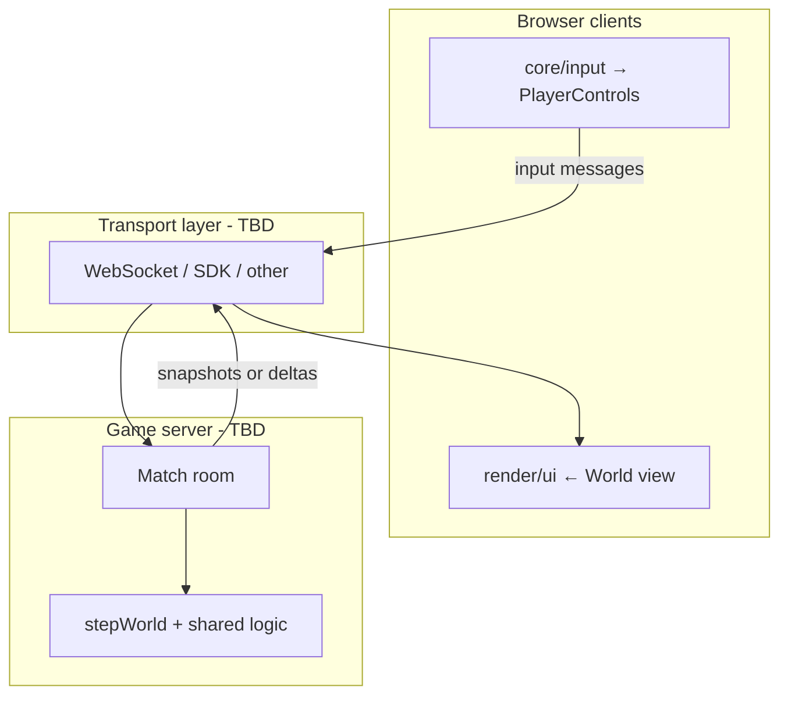
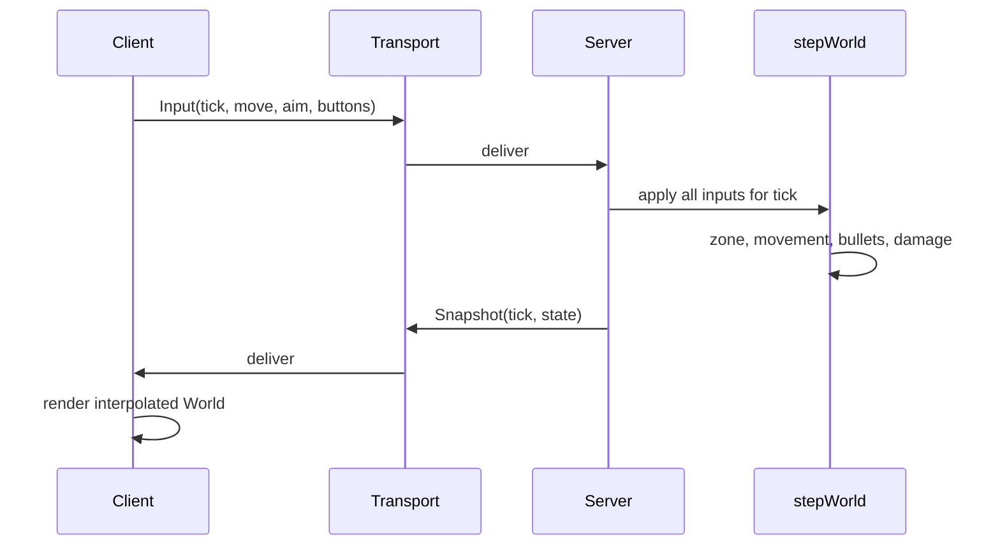

# Online multiplayer (planning)

This document explores how Zone Royale could support **multiple real players online**
while keeping the existing simulation testable and layered. It lists **options only**—no
decisions are locked in yet. Use it for review before implementation.

**Related:** [01_INIT_PROJECT.md](01_INIT_PROJECT.md) (architecture rules, `stepWorld()` order,
`PlayerControls`, single `World`).

**Status:** planning / not implemented.

---

## 1. Where the game is today

| Aspect | Current behaviour |
| ------ | ----------------- |
| Humans | **One** — `world.player` in [`../src/core/world.ts`](../src/core/world.ts) |
| Opponents | **19 AI bots** — same `Entity` shape, `systems/ai.ts` |
| Simulation | **Entirely local** in the browser — [`stepWorld()`](../src/core/simulation.ts) each frame |
| Input | DOM → [`PlayerControls`](../src/systems/player.ts) → `updatePlayer()` |
| Networking | **None** (no WebSocket, no backend game API) |

Bots and the human share combat, bullets, zone, and loot rules; only input source differs.

---

## 2. Goals (candidate)

Possible goals to align on before picking tech (not all required for v1):

- Multiple humans in the **same match** with fair combat (no client-authoritative hits).
- Reuse **`systems/*`** and `stepWorld()` on the server where possible.
- Keep **DOM out of game logic** — transport layer feeds controls and applies snapshots
  ([architecture rules in §3 of 01_INIT_PROJECT.md](01_INIT_PROJECT.md#architecture-rules)).
- Stay **TypeScript**-friendly for shared types and tests.
- Deployable without rewriting the whole client (Vite + Canvas stays).

**Out of scope for an initial doc pass:** anti-cheat at esports level, global matchmaking at
scale, mobile native clients, voice chat.

---

## 3. High-level architecture (conceptual)

**Principle (from project conventions):** sockets and session handling live **outside**
`systems/`—they produce `PlayerControls` (or equivalent) for each connected human and apply
authoritative state to what the client displays.

---

## 4. Authority model (options)

Who runs `stepWorld()` and decides hits?

| Option | Idea | Pros | Cons |
| ------ | ---- | ---- | ---- |
| **A. Dedicated authoritative server** | One server process per match (or per shard) runs full sim | Fair, matches current headless-test story | Ops cost, latency, must implement netcode |
| **B. Listen server (host client)** | One player’s browser hosts; others are clients | No server bill for hobby | Cheating, host quit ends match, NAT issues |
| **C. Peer-to-peer mesh** | Every client simulates and exchanges state | No central sim server | Very hard for ~20 players; trust and sync pain |
| **D. Relay only (no sim)** | Server forwards inputs; clients sim independently | Simple relay | Unsuitable for competitive shooting without lockstep |
| **E. Hosted game backend SDK** | SDK runs room + often state sync (Colyseus, Nakama, Photon, etc.) | Less custom infra | Learning curve, pricing, constraints |

For a BR-style shooter with bullets and armor, **A or E** are the usual starting points;
**B** can work for friends-only prototypes.

---

## 5. Transport (options)

How do clients and the game process exchange data?

| Option | Typical use | Pros | Cons |
| ------ | ----------- | ---- | ---- |
| **WebSocket** | Persistent bidirectional stream | Browser-native, widely supported | Text/binary framing is yours; no UDP |
| **WebSocket + binary codec** | Same, with msgpack/protobuf | Smaller payloads | Schema versioning work |
| **HTTP long polling** | Fallback | Simple | Poor for 10–20 Hz game state |
| **SSE (server → client only)** | One-way streams | Easy push | Inputs still need another channel |
| **WebRTC data channels** | Low latency P2P or client↔server | Can reduce relay latency | Signaling + NAT; often still need WS for signaling |
| **Third-party transport** | Inside Colyseus / Photon / etc. | Abstracted | Less control |

**Common pattern (one of many):** HTTP for **lobby** (create/join room, auth token), **WebSocket**
for **in-match** (input up, state down).

Browsers do not expose raw **UDP**; dedicated game servers sometimes use UDP **outside** the
browser (custom client or gateway), which is a larger product change.

---

## 6. Backend / hosting (options)

| Option | Notes |
| ------ | ----- |
| **Node.js** | Same language as client; run `stepWorld` in a tick loop |
| **Bun** | Faster startup; same TS sharing story |
| **Deno** | Similar to Node; different ecosystem |
| **Serverless functions** | Fine for lobby/API; **long-lived match sim** is awkward (timeouts, no persistent WS on some platforms) |
| **Container on VPS / Fly.io / Railway / Render** | Long-running WS + sim process |
| **Kubernetes / game-specific hosting** | Scale later |
| **Managed multiplayer (Colyseus Cloud, Nakama, Photon, PlayFab, etc.)** | Rooms, sometimes matchmaking; you still plug in rules |

---

## 7. Code layout (options)

How to share `systems/`, `entities/`, `config/` between client and server?

| Option | Layout |
| ------ | ------ |
| **pnpm monorepo** | `packages/client` (Vite), `packages/server`, `packages/game-logic` (sim + systems) |
| **Single repo, path aliases** | `src/` shared; server entry `server/` imports `../src/systems` |
| **Published internal package** | `@zone-royale/sim` built to `dist/` for server |
| **Duplicate logic** | Not recommended; diverges from tests |

Client-only code stays in **render/**, **ui/**, **core/input**, **core/canvas**, **core/audio**
(per [01_INIT_PROJECT.md](01_INIT_PROJECT.md)).

---

## 8. Sync strategy (options)

What travels over the wire each tick?

| Option | Server sends | Client does |
| ------ | ------------ | ----------- |
| **Full snapshot** | Whole `World` (or subset) every N ms | Replace or blend state |
| **Delta / diff** | Changed entities, bullets, zone, loot | Apply patches |
| **Event stream** | “fired”, “damaged”, “died” + periodic correction | Replay + reconcile |
| **Lockstep** | Inputs only; all sims advance same tick | Deterministic sim required everywhere |

**Input direction (usual):** client → server messages carrying movement, aim, fire/reload/
pickup intent—aligned with [`PlayerControls`](../src/systems/player.ts) plus discrete actions
(switch weapon, interact) that today come from [`core/game.ts`](../src/core/game.ts) key handlers.

**Simulation timing options:**

- Server **fixed timestep** (e.g. 30 or 60 Hz) vs tied to wall clock.
- Client **render interpolation** between last two snapshots.
- **Client-side prediction** for local player only (optional, later).

**RNG:** [`utils/random.ts`](../src/utils/random.ts) should be **server-owned** for loot, spread,
and AI if bots remain; clients receive results via state, not local `Math.random()` for rules.

**Map:** Shared **seed** at match start so `createMatch()` builds the same obstacles/houses
(see [`systems/match.ts`](../src/systems/match.ts) / map generation).

---

## 9. Match & session (options)

| Topic | Options |
| ----- | ------- |
| Room model | Ad-hoc room code, browser URL room id, queue-based matchmaking |
| Player count | Full 20 humans vs smaller lobbies vs humans + bots backfill |
| Join in progress | Disallow (BR drop) vs allow spectators |
| Disconnect | Pause, replace with bot, forfeit, reconnect window |
| Identity | Anonymous id, JWT session, OAuth later |

---

## 10. Mapping onto existing code (implementation hooks)

These are **touch points**, not a chosen design:

| Area | Today | Likely multiplayer touch |
| ---- | ----- | ------------------------ |
| `updatePlayer(world, controls)` | One human | Per-connection controls for each human `Entity` |
| `world.player` | Index 0 human | “Local player” pointer vs `entities[]` |
| `updateBot` | All non-player entities with `ai` | Disable or reduce bots as humans join |
| `stepWorld` | Single `PlayerControls` | Multiple inputs per tick (order TBD) |
| `Game` / phases | Local state machine | Server-driven phase or host message |
| Tests | Headless `stepWorld` | Server integration tests + optional multi-client e2e |

---

## 11. Suggested implementation phases (for discussion only)

Order can change after open questions are answered:

1. **Protocol sketch** — message types, version field, error codes (no production server).
2. **Shared sim package** — server can `createMatch` + `stepWorld` in Node without DOM.
3. **Minimal server** — one room, 2 clients, full snapshots, fixed tick.
4. **Client net layer** — connect, send input, display remotes from snapshot.
5. **Lobby** — create/join, ready check, start with shared seed.
6. **Scale & polish** — deltas, prediction, reconnect, metrics.

---

## 12. Open questions (for product / tech review)

Answer these before locking a stack or v1 scope.

### Product & scope

1. **Target player count per match?** (2, 4, 10, full 20?)
2. **Bots when humans &lt; max?** (fill always, only in solo queue, never?)
3. **Is cheating a concern** for the first public release, or friends-only OK initially?
4. **Reconnect** required for v1, or disconnect = elimination?
5. **Spectators** after death or from the start?
6. **Regions / latency** — single region OK, or multi-region from day one?

### Authority & trust

7. **Must the server simulate every bullet**, or is input validation + simplified hit model acceptable for v1?
8. **Client aim:** trust `aimX/aimY` from client vs server re-validate line-of-sight each shot?
9. **Who starts the match** — server only, or vote/ready in lobby?

### Networking & ops

10. **Budget for hosting** — hobby free tier, fixed monthly, or scale-to-zero acceptable?
11. **Long-lived WebSocket processes** acceptable on your chosen host?
12. **Prefer owning netcode** vs **managed SDK** (Colyseus, Nakama, Photon, …)?
13. **Serialization** — JSON first OK, or binary from the start?

### Codebase

14. **Monorepo (`packages/*`)** vs server folder importing `src/`?
15. **Keep single-player offline** as a mode alongside online?
16. **AI bots on server** — same `updateBot` code path, or strip AI for online-only builds?

### Protocol & UX

17. **Tick rate target** (20 / 30 / 60 Hz sim)?
18. **Interpolation** — how “smooth” must remotes feel before prediction is in scope?
19. **Account system** for v1 (guest name only vs login)?

### Legal / platform

20. **Where will it be hosted** (affects WebSocket, GDPR, logging)?
21. **Age / moderation** requirements for public lobbies?

---

## 13. References in this repo

| File | Relevance |
| ---- | --------- |
| [`src/core/simulation.ts`](../src/core/simulation.ts) | Tick order |
| [`src/systems/player.ts`](../src/systems/player.ts) | `PlayerControls` |
| [`src/core/input.ts`](../src/core/input.ts) | Screen → world aim |
| [`src/core/world.ts`](../src/core/world.ts) | State container |
| [`tests/helpers.ts`](../tests/helpers.ts) | Headless world setup |
| [`docs/01_INIT_PROJECT.md`](01_INIT_PROJECT.md) | Layer boundaries |

---

## 14. Decision log

Record choices here when they are made (empty for now).

| Date | Decision | Rationale |
| ---- | -------- | --------- |
| — | — | — |
